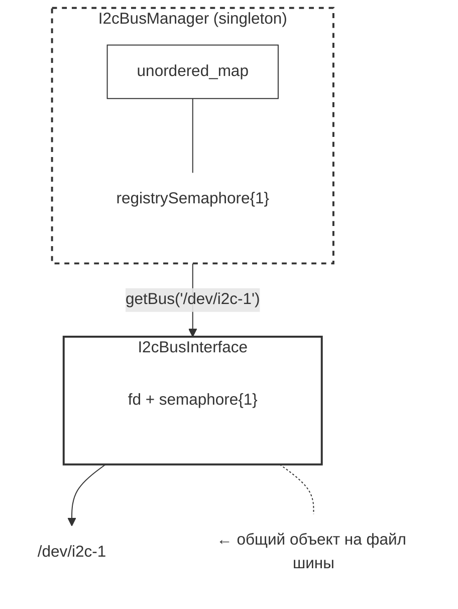

# I2C Bus Manager

Потокобезопасный C++20-менеджер I2C-шин для Raspberry Pi (и других Linux-систем с `/dev/i2c-*`).

Библиотека предоставляет единый реестр I2C-шин (`I2cBusManager`) и атомарный интерфейс доступа к каждой физической шине (`I2cBusInterface`). Разные шины работают параллельно и не блокируют друг друга, а доступ к одной шине синхронизируется через `std::binary_semaphore`.

---

## Особенности

- 🧵 **Потокобезопасность** — каждая шина защищена собственным бинарным семафором C++20.
- 🔀 **Параллелизм между шинами** — операции на `/dev/i2c-1` не блокируют работу с `/dev/i2c-2`.
- 🧩 **Синглтон-реестр** — один объект `I2cBusInterface` на физический файл шины гарантированно для всего приложения.
- 🛡️ **`std::span`** — безопасная передача буферов без копирования и с проверкой границ.
- ⚡ **Атомарные транзакции** — комбинация `write → delay → read` выполняется под семафором (например, для чтения регистров, требующих trigger-write).
- 🧹 **RAII** — деструктор корректно дожидается завершения операций и закрывает файловый дескриптор.

---

## Требования

- Компилятор с поддержкой **C++20** (GCC 11+, Clang 14+).
- Linux с загруженным модулем `i2c-dev` и доступным устройством `/dev/i2c-*`.
- CMake 3.16+.

---

## Сборка

```bash
cmake -B build -DCMAKE_CXX_STANDARD=20
cmake --build build
```
## API

### I2cBusManager

<table>
  <tr>
    <td><b>Метод</b></td>  <td><b>Описание</b></td>
  </tr>
  <tr>
    <td>I2cBusManager& instance()</td> <td>Получение единственного глобального экземпляра реестра (Синглтон).</td>
  </tr>
  <tr>
    <td>std::shared_ptr<I2cBusInterface> getBus(const std::string& devicePath)</td> <td>Получение объекта I2C-шины</td>
  </tr>
</table>


### I2cBusInterface

<table>
  <tr>
    <td><b>Метод</b><</td>  <td><b>Описание</b></td>
  </tr>
  <tr> 
    <td>bool isValid() const noexcept</td> <td>true, если дескриптор успешно открыт.</td>
  </tr>
  <tr> 
    <td>std::string getDevicePath() const noexcept</td> <td>Возвращает путь к устройству.</td>
  </tr>
  <tr> 
    <td>bool readReg(int devAddr, unsigned char reg, std::span<unsigned char> outData)</td> <td>Читает outData.size() байт из регистра reg.</td>
  </tr>
  <tr> 
    <td>bool writeReg(int devAddr, unsigned char reg, unsigned char value)</td> <td>Пишет один байт в регистр reg.</td>
  </tr>
  <tr> 
    <td>bool writeRaw(int devAddr, std::span<const unsigned char> data)</td> <td>Отправляет произвольную последовательность байт.</td>
  </tr>
  <tr> 
    <td>bool transfer(int devAddr, std::span<const unsigned char> txData, std::span<unsigned char> rxData, int postWriteDelayMs = 0)</td> <td>Атомарно: write(txData) → задержка → read(rxData). Полезно для датчиков, требующих write-then-read.</td>
  </tr>
</table>


## Примеры

```cpp
#include "I2cBusManager.h"
#include <array>
#include <iostream>

int main() {
    // Получаем общий указатель на шину /dev/i2c-1
    auto bus = I2cBusManager::instance().getBus("/dev/i2c-1");

    if (!bus->isValid()) {
        std::cerr << "Не удалось открыть I2C шину\n";
        return 1;
    }

    constexpr int SENSOR_ADDR = 0x68;
    constexpr unsigned char WHO_AM_I_REG = 0x75;

    // Чтение одного байта из регистра
    std::array<unsigned char, 1> id{};
    if (bus->readReg(SENSOR_ADDR, WHO_AM_I_REG, id)) {
        std::cout << "WHO_AM_I = 0x"
                  << std::hex << static_cast<int>(id[0]) << "\n";
    }

    // Запись байта в регистр
    bus->writeReg(SENSOR_ADDR, 0x6B, 0x00);  // например, снять с питания

    return 0;
}
```

## Архитектура



- I2cBusManager — только реестр. Защищает unordered_map от гонок.

- I2cBusInterface — защищает одну физическую шину. Семафоры разных экземпляров независимы → параллельная работа с /dev/i2c-1 и /dev/i2c-2 не сериализуется.

- std::shared_ptr — гарантирует, что шина не будет закрыта, пока у пользователя есть хотя бы одна ссылка.

## Права доступа

Для работы с /dev/i2c-* нужны права. Типичное решение — добавить пользователя в группу i2c:

```bash
sudo usermod -a -G i2
```

## Структура проекта

.
├── CMakeLists.txt
├── I2cBusInterface.h     # Интерфейс одной физической шины
├── I2cBusInterface.cpp   # Реализация open/read/write/transfer
├── I2cBusManager.h       # Singleton-реестр шин
├── I2cBusManager.cpp     # Реализация getBus()
└── README.md

